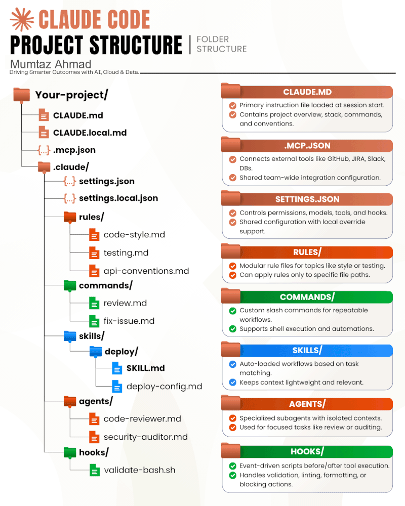

# Signal Forms Preview

A hands-on demo of **[`@angular/forms/signals`](https://angular.dev/guide/forms/signals/overview)**
("Signal Forms") — Angular's experimental, signal-first replacement for template-driven and
reactive forms — built on **Angular 22**.

There's no `FormGroup`, `FormControl`, or forms module to import. A form is just a plain
`WritableSignal` of your data model, wrapped by `form()` with a schema function that attaches
validation and behavior rules to any path in that model. Everything in the UI — field errors,
visibility, disabled state, dirty/touched flags, submission — is a reactive signal read straight
off that one `FieldTree`.

## What the demo covers

The single application form (`src/app/app.ts` / `app.html`) exercises most of the Signal Forms
surface area:

- **Model-driven form** — `form(signal(model), schemaFn, options)`, no modules.
- **Native control binding** — `[formField]` on `<input>`, `<select>`, `<textarea>`, and checkbox.
- **Standard validators** — `required`, `email`, `min`, `max`, `minLength`, `maxLength`, `pattern`.
- **Cross-field validation** — `validate()` reads a sibling field's value via the field context
  (password confirmation).
- **Conditional fields** — `hidden()` + `required({ when })` show/require "Company" only when
  employed; `disabled({ when })` disables "Referral code" (with a reason) unless relevant.
- **Dynamic arrays** — `applyEach()` validates each item in the "Skills" list, which grows/shrinks
  by mutating the field's own `value` signal.
- **Debounced input** — `debounce()` delays the "Bio" field's model updates by 400ms.
- **Automatic status classes** — `provideSignalFormsConfig({ classes })` in `app.config.ts` toggles
  CSS classes on bound elements based on their `FieldState`, with zero `[class.x]` bindings in the
  template.
- **Form submission** — `submission.action` + `[formRoot]` simulate an async server call, including
  returning a targeted server-side validation error (try submitting with `taken@example.com`).
- **Live state inspector** — a sidebar that mirrors `appForm()`'s reactive state (valid, dirty,
  touched, pending, error summary) and the raw model JSON.

The app also runs **zoneless** (no `zone.js` dependency) and uses the new built-in control flow
(`@if`, `@for`) throughout.

## Development server

```bash
npm install
ng serve
```

Then open `http://localhost:4200/`.

## Building

```bash
ng build
```

Build artifacts are written to `dist/`.

## Running unit tests

```bash
ng test
```

Runs via [Vitest](https://vitest.dev/).

## Project structure

```
src/app/
  app.ts            — the schema + component class
  app.html           — the form template + state inspector
  app.css             — layout/visual styling
  app.config.ts      — provideSignalFormsConfig() status classes
  models.ts          — ApplicationModel + option lists
  field-errors.ts    — small reusable <app-field-errors> component
```

## Claude Code project structure



This repo is also set up as a full Claude Code project — instructions, rules, commands, a skill,
subagents, and a safety hook, so Claude Code (or any contributor using it) has the same context
and guardrails every session. See `HOW_TO_RUN.txt` for how to invoke each piece.

```
.
├── CLAUDE.md                     primary instructions, loaded every session
├── CLAUDE.local.md               personal notes (gitignored)
├── .mcp.json                     GitHub MCP server config (token via env var)
└── .claude/
    ├── settings.json             permissions allowlist/denylist + hook wiring
    ├── settings.local.json       personal override (gitignored)
    ├── rules/                    conventions auto-loaded by file path
    │   ├── code-style.md         — Angular/TypeScript style (signals, OnPush, no ngClass/ngStyle…)
    │   ├── testing.md            — Vitest conventions for this repo
    │   └── api-conventions.md    — Signal Forms schema + component-input conventions
    ├── commands/                 slash commands
    │   ├── review.md             — /review: diff review against build, tests, and conventions
    │   └── fix-issue.md          — /fix-issue <n>: fetch a GitHub issue, fix it, open a PR
    ├── skills/
    │   └── deploy/                — /deploy (or "deploy this"): build, push, and verify the
    │       ├── SKILL.md             GitHub Pages deploy end-to-end
    │       └── deploy-config.md   — repo/workflow/URL reference
    ├── agents/                   subagents with isolated context
    │   ├── code-reviewer.md      — read-only Angular/Signal Forms code review
    │   └── security-auditor.md   — read-only secrets/CI/template-safety audit
    └── hooks/
        └── validate-bash.sh      — PreToolUse hook; blocks force-push, reset --hard, etc.
```
